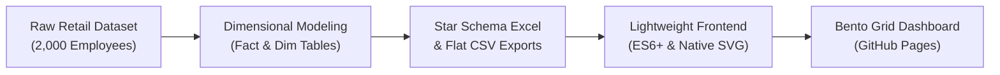

# 📊 Retail Workforce Productivity & Attrition Analysis

[](https://wijaya-rama.github.io/portfolio-retail-workforce/)
[](LICENSE)
[](https://developer.mozilla.org/en-US/docs/Web/JavaScript)
[](data/)

> **Interactive People Analytics & Workforce Productivity Dashboard** evaluating employee turnover dynamics, leadership styles, labor cost structures, and high-performer retention across **2,000 retail employees** and **24 stores** over 2024–2025.

🔗 **[Launch Interactive Dashboard (Live Demo)](https://wijaya-rama.github.io/portfolio-retail-workforce/)**

---

## 📌 Executive Summary

In high-volume retail operations, employee attrition and escalating labor cost percentages directly erode store-level profitability and customer experience. This project conducts an end-to-end People Analytics investigation across 24 stores in 3 operational regions (*Midwest*, *South*, *West*), tracking 2,000 active and former personnel over a two-year timeline.

Built upon a **Takeaway-First Storytelling** methodology and a responsive **Bento Grid Architecture**, the dashboard provides actionable, evidence-based intelligence for Chief Human Resources Officers (CHRO), Retail Operations Directors, and Regional General Managers.

---

## 💡 Key Business Insights

```
┌────────────────────────────────────────────────────────────────────────────────────────┐
│                                   CORE TAKEAWAYS                                       │
├──────────────────────────┬──────────────────────────┬──────────────────────────────────┤
│   Micromanagement Risk   │   Store Inefficiencies   │       Star Talent Attrition      │
│          48.8%           │      Express Stores      │               20.7%              │
│  Team attrition rate     │   Highest labor cost %   │    1 in ~5 high-potentials quit  │
│  under micromanagers     │   Bottom revenue/emp.    │    (Not driven by compensation)  │
└──────────────────────────┴──────────────────────────┴──────────────────────────────────┘
```

### 1. Leadership Style Drives Retention: Micromanagement vs. Attrition (48.8%)
* Teams supervised by managers exhibiting a **Micromanagement** leadership style suffered an aggregate attrition rate of **48.8%**, compared to just **~12% – 14%** under **Coaching** and **Standard** managers.
* Micromanaging supervisors accounted for a disproportionate share of all voluntary exits. Scatter plot regression confirms a steep negative correlation between a manager's leadership score and their team's annualized turnover rate.

### 2. Operational Inefficiency in Express Store Formats
* **Express format stores** consumed a significantly larger share of top-line revenue on labor costs relative to **Regular** and **Superstore** formats.
* Across all regions, Express stores consistently clustered at the bottom of **Revenue per Employee (RPE)** metrics, exposing sub-optimal shift scheduling, rigid staffing ratios, and low sales productivity during off-peak hours.

### 3. High-Performer Vulnerability: 20.7% Star Talent Attrition (9-Box Grid)
* Analysis across the **9-Box Performance vs. Potential Matrix** revealed an alarming retention leak: **20.7% (approximately 1 in 5) of categorized Star Talents resigned**.
* Contrary to standard assumptions, compensation was **not** the primary exit trigger: the average *compa-ratio* of departed talent (**0.98**) was virtually identical to those who stayed (**0.99**). Exit interviews and satisfaction correlations demonstrate that poor managerial empowerment, burnout, and stagnant career progression prompted top talent to leave.

### 4. Critical Tenure Window: First-Year Vulnerability (< 1 Year)
* Turnover risk peaked sharply within the first 12 months of employment. New hires (< 1 year tenure) experienced significantly higher drop-out rates than seasoned staff (5+ years), underscoring an acute onboarding gap.

---

## 🎯 Strategic Management Recommendations

| Strategic Pillar | Target Metric | Recommended Intervention |
| :--- | :--- | :--- |
| **1. Leadership Transformation** | Reduce team turnover to < 20% | Implement manager coaching academies; reassign or restructure teams led by persistent micromanagers before adjusting payroll budgets. |
| **2. New-Hire Shielding** | Decrease 1st-year attrition by 30% | Establish a structured buddy system with mandatory, structured check-ins at Month 3 and Month 6. |
| **3. Star Talent Retention Protocol** | Retain ≥ 90% of 9-box top performers | Launch individualized career pathways (IDP), priority project rotations, and quarterly leadership skip-level dialogues. |
| **4. Express Store Workforce Optimization** | Lower Express labor cost by 2.5 pts | Introduce dynamic shift scheduling based on hourly footfall rather than static full-day coverage. |

---

## 🛠️ Data Architecture & Tech Stack



### 1. Data Modeling & Storage (`data/`)
* **`Retail_Workforce_Productivity_StarSchema.xlsx`:** Enterprise-grade relational dimensional model consisting of:
  * **Fact Table:** `Fact_Monthly_Productivity` (monthly store revenue, labor cost, headcounts, satisfaction scores).
  * **Dimension Tables:** `Dim_Employee`, `Dim_Store`, `Dim_Manager`, and `Dim_Date`.
* **`Retail_Workforce_Productivity_Flat_2000.csv`:** Clean, denormalized master record containing granular employee profiles (demographics, 9-box category, compa-ratio, tenure, flight risk, exit reasons, and operational KPIs).

### 2. Frontend Engineering & Visual Design
* **Zero External Dependencies:** Built entirely with **Semantic HTML5** and **Vanilla JavaScript (ES6+)** — zero heavy npm packages, bundlers, or third-party charting bloat.
* **Native Scalable Vector Graphics (SVG):** Custom dynamic bar charts, sparklines, and interactive scatter plots rendered directly into the DOM for 60fps performance and instantaneous (<100ms) load times.
* **Modern Bento Grid UI:** Clean data-ink ratio, WCAG-compliant contrast, integrated dark/light theme switcher, and instant **Bilingual Toggle (EN / ID)**.

---

## 📂 Repository Structure

```text
portfolio-retail-workforce/
├── index.html       # Production-ready interactive dashboard (GitHub Pages entry point)
├── .gitignore       # Git exclusion rules for OS, IDE, and temporary files
├── README.md        # Executive portfolio documentation & business insights
└── data/            # Source data assets
    ├── Retail_Workforce_Productivity_Flat_2000.csv       # Denormalized master CSV
    └── Retail_Workforce_Productivity_StarSchema.xlsx      # Relational dimensional model
```

---

## 🚀 How to Run the Dashboard

### Option 1: Direct Local Execution (Instant)
Because this application is completely self-contained with no build steps or backend servers:
1. Clone this repository:
   ```bash
   git clone https://github.com/wijaya-rama/portfolio-retail-workforce.git
   cd portfolio-retail-workforce
   ```
2. Double-click [`index.html`](index.html) or open it with any modern web browser (Google Chrome, Microsoft Edge, Mozilla Firefox, Safari).

### Option 2: Run via Local HTTP Server
* **Using Python 3:**
  ```bash
  python -m http.server 8000
  ```
  Open `http://localhost:8000` in your browser.
* **Using VS Code:**
  Right-click `index.html` and select **Open with Live Server**.

### Option 3: Host on GitHub Pages (Free Cloud Deployment)
1. Push this repository to your GitHub account.
2. In your GitHub repository, navigate to **Settings** > **Pages**.
3. Under **Build and deployment** > **Source**, select **Deploy from a branch**.
4. Set the branch to `main` and folder to `/ (root)`, then click **Save**.
5. Your interactive dashboard will be live at:
   `https://wijaya-rama.github.io/portfolio-retail-workforce/`

---

## 👤 Author & Contact

**Rama Wijaya**  
*Data Analyst | People Analytics & Business Intelligence*

* **LinkedIn:** [linkedin.com/in/ramawijaya1](https://www.linkedin.com/in/ramawijaya1)
* **GitHub:** [@wijaya-rama](https://github.com/wijaya-rama)
* **Portfolio Repo:** [portfolio-retail-workforce](https://github.com/wijaya-rama/portfolio-retail-workforce)
* **Live Dashboard:** [wijaya-rama.github.io/portfolio-retail-workforce](https://wijaya-rama.github.io/portfolio-retail-workforce/)

---

## 📄 License

This project is licensed under the [MIT License](LICENSE) — feel free to adapt and reference this project for analytics and portfolio benchmarking.
